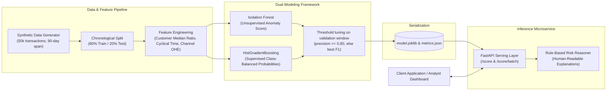
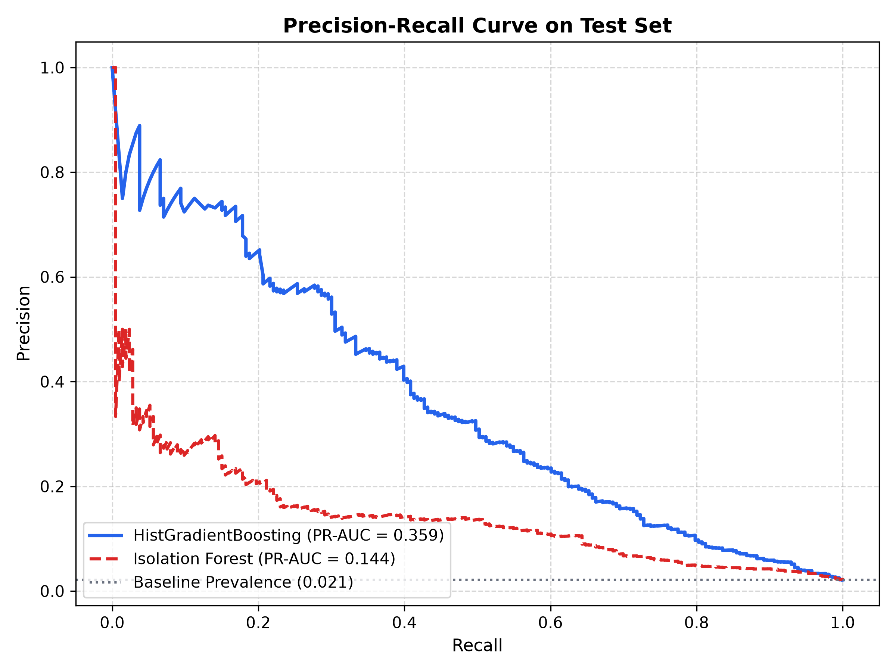
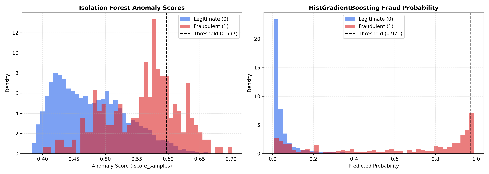

# Transaction Fraud & Anomaly Detection

[](https://github.com/pulok529/transaction_fraud_anomaly/actions/workflows/ci.yml)


An end-to-end fraud and anomaly detection project on synthetic card transactions. It compares an unsupervised **Isolation Forest** (no labels needed) with a supervised **HistGradientBoostingClassifier** (class-balanced), using a leak-free chronological split, thresholds tuned on a held-out validation window, rule-based explanations for each alert, and a containerised FastAPI scoring service.

---

## Architecture



---

## Project Structure

```text
transaction_fraud_anomaly/
├── .github/
│   └── workflows/
│       └── ci.yml                     # Multi-version Python test & Docker healthcheck CI
├── api/
│   ├── __init__.py
│   └── main.py                        # FastAPI app with health, single, and batch endpoints
├── notebooks/
│   └── 01_training_walkthrough.ipynb  # End-to-end data exploration, training & evaluation
├── src/
│   └── fraud_anomaly/
│       ├── __init__.py                # Package exports and version 1.0.0
│       ├── data.py                    # Synthetic transaction generator with realistic priors
│       ├── features.py                # Feature transformations & single-instance extractor
│       ├── model.py                   # Bundle loader, dual scoring & explainable reasoning
│       └── train.py                   # Train CLI, chronological split, metrics & plots
├── tests/
│   ├── __init__.py
│   ├── test_api.py                    # TestClient API integration & validation tests
│   ├── test_data.py                   # Generator distributions and CSV I/O tests
│   └── test_features.py               # Feature calculations & edge-case unit tests
├── .dockerignore
├── .gitignore
├── Dockerfile                         # Slim multi-stage container with non-root user
├── LICENSE                            # MIT License
├── Makefile                           # Development, test, lint, and run automations
├── pyproject.toml                     # Modern PEP 517/621 packaging & Ruff/Pytest configs
├── README.md
├── requirements-dev.txt               # Development dependencies
├── requirements.txt                   # Production runtime dependencies
```

---

## Key Features

1. **Realistic Synthetic Behavioral Generator**: Generates 50,000 transactions across ~5,000 customers over a 90-day time window. Models per-customer baseline spending levels, daytime circadian shopping curves, channel biases (POS, Online, ATM), cross-border transactions, and country/merchant risk scores.
2. **Leakage-Free Time Split**: Enforces an 80/20 chronological time boundary, ensuring the model is evaluated on future transactions without look-ahead bias.
3. **Dual Model Strategy**:
   - **Isolation Forest**: Unsupervised tree ensemble assessing partition depth in feature space, outputting min-max normalized anomaly scores $[0, 1]$.
   - **HistGradientBoostingClassifier**: High-throughput supervised gradient-boosted decision trees trained with balanced class weights to capture known fraud signatures.
4. **Validation-tuned thresholds**: the most recent 20% of the training window is held out; each model's cut-off is the highest-recall threshold reaching precision >= 0.80 there, falling back to best F1 when that precision is unreachable.
5. **Human-Readable Risk Explanations**: Scores are accompanied by transparent business reasons (e.g., spend ratio exceeding customer median, anomalous night hours, high-risk destination countries).
6. **Containerized API with Cold-Start Resilience**: The FastAPI service loads `artifacts/model.joblib` or automatically trains an initial model if the artifact is missing, ensuring zero-downtime container starts.

---

## Results

Evaluation metrics computed on the unseen chronological holdout test partition (last 20% of the 90-day timeline):

Test window = last 20% of the 90-day period (9,936 transactions, 2.1% fraud). Trained with `python -m fraud_anomaly.train --n 50000`.

| Model | ROC-AUC | PR-AUC | Precision | Recall | F1 | Threshold |
|---|---|---|---|---|---|---|
| Isolation Forest (unsupervised) | 0.833 | 0.144 | 0.161 | 0.268 | 0.201 | 0.597 |
| HistGradientBoosting (supervised) | 0.898 | 0.359 | 0.737 | 0.132 | 0.223 | 0.971 |

**Reading the numbers.** With a 2% base rate, a random model has PR-AUC ≈ 0.02, so the supervised model ranks fraud about 17x better than chance. The synthetic data deliberately includes three fraud archetypes (account takeover, card-not-present abroad, low-value card testing) plus legitimate customers who also spend big, shop at night or travel, so no single feature gives the answer away. The supervised model is tuned for few false alarms (74% precision) at the cost of recall; lowering its threshold trades precision for recall (see the precision-recall curve below).

<p align="center"> </p>

*(The table above is generated automatically by running the training pipeline: `make train` or `python -m fraud_anomaly.train`)*.

---

## How Scoring & Risk Reasons Work

When a transaction is submitted to `/score`:

1. **Feature Transformation**:
   - The transaction amount is log-transformed (`log_amount`).
   - If historical customer median spend is provided, the ratio `amount / customer_median` is derived; if unknown, defaults safely to `1.0`.
   - `hour` is mapped to cyclical trigonometric representations (`hour_sin`, `hour_cos`) and evaluated against the night window (`22:00 - 05:00`).
   - Transaction channel (`pos`, `online`, `atm`), `country_risk`, `merchant_risk`, and `is_foreign` are formatted into numeric feature vectors.
2. **Inference**:
   - **Anomaly Score**: Raw Isolation Forest partition path lengths are inverted and scaled against training set minimum and maximum bounds to output a continuous metric in $[0, 1]$.
   - **Fraud Probability**: HistGradientBoosting calculates posterior probability $P(\text{fraud} \mid x)$.
   - **Decision**: `is_fraud` is set to `True` if `fraud_probability >= threshold`.
3. **Reason Extraction**: The system flags active rule triggers:
   - Amount exceeds customer baseline by $> 3.0\times$.
   - Transaction executed in night window (`22:00 - 05:00`).
   - Destination country risk $> 0.70$.
   - Merchant category risk $> 0.70$.
   - Cross-border transaction executed via digital/online channel.

---

## Quick Start

### 1. Local Setup

```bash
# Clone repository
git clone https://github.com/pulok529/transaction_fraud_anomaly.git
cd transaction_fraud_anomaly

# Create and activate virtual environment
python -m venv .venv
source .venv/bin/activate  # On Windows: .venv\Scripts\activate

# Install dependencies
pip install -r requirements-dev.txt

# Run linting and test suite
ruff check .
pytest -v
```

### 2. Training the Models

Generate synthetic data, train the dual models, optimize thresholds, and produce visual curves:

```bash
python -m fraud_anomaly.train --n 50000 --out artifacts/
```

Generated artifacts:
- `artifacts/model.joblib`: Trained model bundle and threshold metadata.
- `artifacts/metrics.json`: Detailed performance metrics.
- `artifacts/pr_curve.png`: Precision-Recall curve comparison on holdout test set.
- `artifacts/score_hist.png`: Score distributions separating normal vs. fraudulent transactions.

### 3. Launching the API Service

```bash
uvicorn api.main:app --host 0.0.0.0 --port 8000 --reload
```

Interactive documentation is available at `http://localhost:8000/docs`.

### 4. Running with Docker

```bash
# Build the Docker image (trains artifact at build time)
docker build -t fraud-anomaly:latest .

# Run the container
docker run -p 8000:8000 --name fraud-api fraud-anomaly:latest
```

Verify service health:
```bash
curl http://localhost:8000/health
```

---

## API Usage Examples

### Health Check

```bash
curl -X GET http://localhost:8000/health
```

```json
{
  "status": "ok",
  "model_version": "1.0.0"
}
```

### Score a Single Transaction

```bash
curl -X POST http://localhost:8000/score \
  -H "Content-Type: application/json" \
  -d '{
    "amount": 3450.00,
    "hour": 3,
    "day_of_week": 6,
    "channel": "online",
    "country_risk": 0.88,
    "merchant_risk": 0.92,
    "is_foreign": true,
    "customer_median_amount": 45.00
  }'
```

**Response:**
```json
{
  "fraud_probability": 0.9632,
  "anomaly_score": 0.8415,
  "is_fraud": true,
  "reasons": [
    "Transaction amount is 76.7x higher than customer typical spend",
    "Transaction occurred during unusual night-time window (22:00 - 05:00)",
    "High destination country risk score (0.88)",
    "High merchant category risk score (0.92)",
    "Cross-border transaction conducted via digital/online channel"
  ],
  "model_version": "1.0.0"
}
```

### Batch Scoring (Up to 1,000 Transactions)

```bash
curl -X POST http://localhost:8000/score/batch \
  -H "Content-Type: application/json" \
  -d '[
    {
      "amount": 25.00,
      "hour": 14,
      "day_of_week": 2,
      "channel": "pos",
      "country_risk": 0.08,
      "merchant_risk": 0.12,
      "is_foreign": false,
      "customer_median_amount": 30.00
    },
    {
      "amount": 4200.00,
      "hour": 2,
      "day_of_week": 5,
      "channel": "online",
      "country_risk": 0.85,
      "merchant_risk": 0.78,
      "is_foreign": true,
      "customer_median_amount": 50.00
    }
  ]'
```

---

## Limitations

- **Synthetic Data**: The dataset is entirely synthetically generated to model realistic transactional behaviors without exposing personally identifiable information (PII) or proprietary financial data.
- **Decision Support Only**: This system is designed as an investigative decision-support and triage tool for fraud operations teams, not an automated system for real-time production account blocking.
- **Drift & Recalibration**: Real-world fraud patterns evolve rapidly. Production implementations require continuous monitoring of concept drift and automated retraining pipelines.

---

## Roadmap

- [ ] Online feature store integration (Redis / Feast) for real-time rolling customer velocity features (e.g., transaction count in last 1h/24h).
- [ ] SHAP / TreeSHAP kernel integration for local feature attribution alongside heuristic rule reasons.
- [ ] Conformal prediction intervals for calibrated risk uncertainty bounds.
- [ ] Prometheus metrics instrumentation (`/metrics`) for latency and anomaly score drift tracking.

---

## License

This project is licensed under the terms of the [MIT License](LICENSE). Copyright (c) 2026 Naimul Islam.
